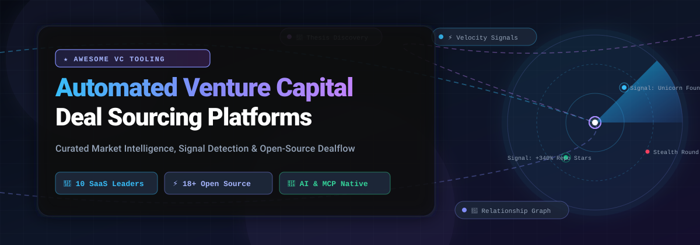
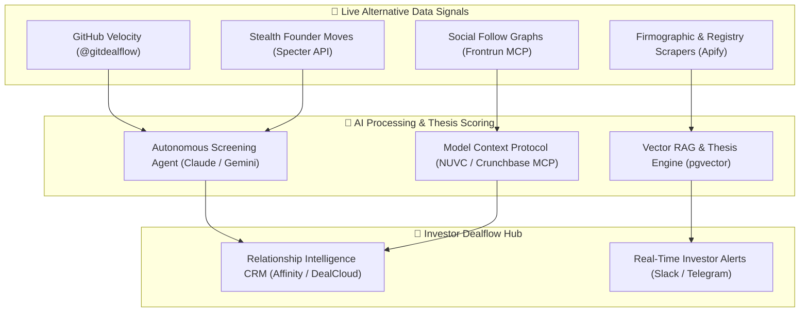

  

  

---

# 🚀 Awesome Automated Venture Capital Deal Sourcing Platforms

> **A curated index of top-tier SaaS platforms, AI-native discovery engines, Model Context Protocol (MCP) servers, and open-source intelligence tools for automated venture capital and private equity deal sourcing.**

*Focusing on developer velocity signals, executive talent migration, relationship intelligence graphs, and thesis-driven startup screening.*

**Last updated:** October 2026

---

## 🔍 SEO & Ecosystem Overview

| Meta Property | Ecosystem Details |
| :--- | :--- |
| **Primary Domain** | Venture Capital (VC), Private Equity (PE), M&A Corporate Development, Angel Syndicates |
| **Focus Capabilities** | Automated Deal Sourcing, Pre-Round Signal Detection, Relationship Intelligence, Thesis Matching |
| **Tool Types** | Enterprise SaaS Platforms, Open-Source Scraping Frameworks, Agent Skills, MCP Servers |
| **Target Audience** | General Partners (GPs), Investment Associates, Deal Scouts, LPs, FinTech Developers |
| **Key Signals Tracked** | GitHub Contributor Velocity, Founder Stealth Filings, X/LinkedIn Follow Graphs, Hiring Surges |

---

## 📑 Table of Contents

- [🌐 Sector Overview & Market Dynamics](#-sector-overview--market-dynamics)
- [🏢 SaaS & Hosted Deal Sourcing Platforms](#-saas--hosted-deal-sourcing-platforms)
- [⚡ Open-Source GitHub Projects](#-open-source-github-projects)
- [🛠️ Recommended Architecture for Custom Sourcing Stacks](#️-recommended-architecture-for-custom-sourcing-stacks)
- [🤝 How to Contribute](#-how-to-contribute)
- [💖 Support & Community](#-support--community)
- [📈 Star History](#--star-history)
- [⚖️ Disclaimer](#️-disclaimer)

---

## 🌐 Sector Overview & Market Dynamics

The global Venture Capital Management & Private Market Intelligence software market is currently valued at **$3.0 Billion to $3.5 Billion** (as part of the broader **$5.5 Billion+** Alternative Investment software industry), expanding at a **compound annual growth rate (CAGR) of ~12.4%** through 2032. 

The sector exhibits **moderate fragmentation with tier-based concentration**: while legacy institutional giants (PitchBook, DealCloud) maintain strong dominance over authoritative private-company directory databases and compliance-heavy deal management, rapid innovation across AI agents, relationship mapping (Affinity, Harmonic), and open-source MCP signal providers has prevented a winner-take-all monopoly. Modern investment firms increasingly run a composable deal stack—pairing a structured directory or CRM with specialized autonomous signal bots and self-hosted screening models.

---

## 🏢 SaaS & Hosted Deal Sourcing Platforms

The table below ranks the leading commercial SaaS platforms for deal discovery and relationship intelligence, sorted in **descending order by company size** (market capitalization, enterprise valuation, or annual recurring revenue).

| 🏢 Platform | 💰 Company Size (Valuation / Revenue) | 🏷️ Specific Starting Price | 🎁 Specific Free Tier / Trial Limits | 🎯 Core Deal Sourcing Capabilities |
| :--- | :--- | :--- | :--- | :--- |
| **[PitchBook](https://pitchbook.com/)** | **~$14.0 Billion Market Cap** (Parent: Morningstar NASDAQ: MORN) / **~$671.8M ARR** | **$12,000 / year** ($1,000/mo equivalent, single-user annual contract) | **30-day trial** via sales qualification; capped at **40 company profile views**, 0 bulk data exports, and no API access. No permanent free tier. | Institutional-grade private market data with 3.5M+ company profiles, detailed VC/PE financing history, debt multiples, and cap table analytics. |
| **[DealCloud (Intapp)](https://www.intapp.com/)** | **~$2.7 Billion Market Cap** (Parent: Intapp NASDAQ: INTA) / **~$600M Annual Revenue** | **$15,000 / user / year** ($1,250/mo per user; minimum annual deployment contract floor ~$85,000/yr) | **14-day guided proof-of-concept trial** upon enterprise sales scoping; 0 self-serve trial. No permanent free tier. | Comprehensive pipeline management, relationship intelligence, co-investment syndication tracking, and compliance workflows tailored for PE/VC. |
| **[Harmonic](https://harmonic.ai/)** | **$1.45 Billion Valuation** (Series C unicorn, $295M raised) | **$25,000 / year** (~$2,083/mo minimum annual commitment) | **14-day guided sandbox trial** upon sales consultation; full query access to 35M+ companies and 195M people profiles. No permanent free tier. | AI-powered Scout natural language discovery engine, talent migration tracking from big tech labs, and automated saved searches matching investment theses. |
| **[Crunchbase](https://www.crunchbase.com/)** | **~$250 Million Valuation** ($106.5M raised) / **~$45M ARR** | **$49 / month** ($588/yr billed annually for Pro) or **$199 / month / seat** for Business | **Free Basic account forever** (firmographics & view-only search, 0 exports/mo); **7-day free trial** of Pro tier (capped at 2,000 row CSV exports/mo). | 30M+ verified annual company updates, seven predictive machine-learning models (84% funding prediction accuracy), and remote MCP server for AI integration. |
| **[Grata](https://grata.com/)** | **~$120 Million Valuation** (Acquired by Datasite in 2025; $35M raised) / **~$25M ARR** | **$15,000 / year** ($1,250/mo billed annually for Growth tier) | **14-day proof-of-concept trial** upon sales request; sample target list discovery and Excel add-in testing. No permanent free tier. | AI-native search engine for private middle-market businesses, proprietary industry taxonomy NLP, owner-operator transition signals, and CRM sync. |
| **[Affinity](https://www.affinity.co/)** | **~$100 Million+ Valuation** ($120M+ raised) / **~$56M ARR** | **$2,000 / user / year** (~$166/mo equivalent for Essential tier; typical firm annual minimum ~$20,000/yr) | **14-day structured pilot trial** upon sales qualification; connection to email/calendar graph for relationship scoring test. No permanent free tier. | Automated relationship scoring, communication graph intelligence, index of 200,000+ high-growth startups, and Deal Assist pitch deck parsing. |
| **[SourceScrub](https://www.sourcescrub.com/)** | **~$90 Million Valuation** / **~$64M–$80M ARR** | **$20,000 / year** (~$1,666/mo baseline enterprise contract) | **7-day guided trial evaluation** following an executive sales demo; curated target lists and verified company records. No permanent free tier. | Private company bootstrapper discovery, trade show attendance tracking, digital footprint analysis, and executive hiring momentum signals. |
| **[Tracxn](https://tracxn.com/)** | **~$45 Million Market Cap** (NSE/BSE: TRACXN; ₹360 Cr) / **~$10M Revenue** (₹84 Cr) | **$500 / month** ($6,000/yr billed annually) | **Tracxn Lite plan free forever** (capped at 10 company profile views/month, basic funding summaries, 0 bulk exports); optional 14-day trial pack. | Emerging technology company tracking across 30+ geographic regions, funding round databases, cap-table breakdowns, and sector taxonomy maps. |
| **[Specter](https://tryspecter.com/)** | **~$40 Million Valuation** ($12.5M raised) / **~$10M ARR** | **$500 / month** ($6,000/yr billed annually) | **Free tier with 200 platform credits forever**; Specter MCP server provides **100 free AI queries/day**; paid tiers unlock live web signals. | Talent migration alerts, stealth startup decoding via founder social breadcrumbs, dynamic monthly valuation re-rating models, and MCP toolsets. |
| **[Cyndx](https://www.cyndx.com/)** | **~$25 Million Valuation** ($10M raised) / **~$5.7M ARR** | **$12,000 / year** ($1,000/mo billed annually for Finder deal sourcing module) | **Cyndx Owner plan free forever** (capped at up to 50 shareholders/cap-table records); Finder/Raiser modules offer a 14-day sales demo sandbox. | Semantic startup discovery (*Finder*), AI-driven investor-founder matching (*Raiser*), cap-table tracking (*Owner*), and valuation benchmarking. |

---

## ⚡ Open-Source GitHub Projects

Below are active open-source repositories, developer toolkits, and autonomous agents for self-hosted VC deal sourcing, startup intelligence, and due diligence. **Sorted in descending order by GitHub Stars_Count**.

1. **[OpenBook](https://github.com/iloveitaly/openbook)**   
   *Like PitchBook, but open.* An open-source investor and venture capital intelligence database engineered to provide an accessible, community-maintained alternative to proprietary paywalled data providers.

2. **[VC Holy Grail](https://github.com/alexnakagawa/vc_holy_grail)**   
   Machine learning pipeline and feature engineering toolkit predicting the likelihood of success for early-stage startups and founding teams based on historical venture backing trajectories.

3. **[Automated Venture Capitalist](https://github.com/ghamut/automated-venture-capitalist)**   
   Reference code implementation for the AAAI-KDF'20 paper *"The Automated Venture Capitalist"*. Demonstrates thesis-based screening algorithms and automated company valuation scoring using knowledge graphs.

4. **[Crunchbase MCP Server](https://github.com/Cyreslab-AI/crunchbase-mcp-server)**   
   Model Context Protocol (MCP) server for Crunchbase's REST API. Equips Claude Desktop, Cursor, and autonomous agents with real-time company firmographics, funding rounds, and investor intelligence tools.

5. **[VC Technical Due Diligence Engine](https://github.com/taka-avantgarde/Due-diligence-engine)**   
   AI-powered technical due diligence engine designed for venture capital funds. Automates architecture validation, detects "AI-washing" in pitch materials, and computes confidence scores on Claude Opus.

6. **[Tomasz Tunguz AI-Associate](https://github.com/ttunguz/AI-Associate)**   
   AI-powered investment analysis and dealflow management framework created by Tomasz Tunguz (Theory Ventures) for streamlining venture capital evaluations and deal memorandum generation.

7. **[VCSkills Curated Agent Library](https://github.com/Overdrive-Consulting/vcskills)**   
   Curated agent skill library, knowledge packs, and MCP resources for GPs, investment analysts, and fund operators to automate market research, cap sheet analysis, and thesis exploration.

8. **[VC Intelligence Skills for Claude](https://github.com/isanthoshgandhi/venture-capital-intelligence)**   
   Nine modular skills for venture capital operations: three pure reasoning modules and six deterministic Claude + Python tools for startup screening, cap table waterfalls, deal signal scanning, and LP reporting.

9. **[Claude Skills CRE & Deal Lifecycle](https://github.com/sasha-deneux/claude-skills-cre)**   
   Open Claude skills spanning the full deal lifecycle: off-market target sourcing, deal screening, underwriting, financial statement normalization, and investor committee memorandum drafting.

10. **[n8n AI Deal Sourcing CRM](https://github.com/abubakkarsiddik0181/n8n-ai-deal-sourcing-crm)**   
    Automated deal sourcing and CRM enrichment pipeline combining n8n workflows, HubSpot, Apify web scrapers, Gmail, and instant Telegram deal alerts for private market acquirers.

11. **[Private Equity Deal Sourcing RAG Platform](https://github.com/aiambo08/PE_mvp)**   
    Institutional-grade PE deal sourcing and financial due diligence RAG platform. Combines automated web scraping, deterministic 0–100 thesis scoring, LBO covenant modeling, and 100% on-premise local GPU inference.

12. **[Frontrun MCP Server](https://github.com/jongall45/frontrun-mcp-server)**   
    VC follow-signal intelligence for AI agents (29 tools). Surfaces pre-round funding signals by tracking follow graphs and interaction dynamics across 1,000+ top venture investors on X.

13. **[Deal Desk Human-in-the-Loop Orchestrator](https://github.com/JackJanoian/deal-desk)**   
    Self-hosted human control plane for AI deal sourcing. Orchestrates autonomous AI business development analysts against target investment theses with approval workflows.

14. **[Claude Code Deal Origination System](https://github.com/corebits-io/deal-origination-system)**   
    Deal origination system for PE, search funds, and family offices. Features 6 agents and 9 skills covering target discovery, founder background research, verified contact discovery, and pipeline management.

15. **[AI-Powered VC Discovery Agent](https://github.com/arifibayrak/vc-discovery-agent)**   
    AI agent for automated startup pitch screening. Ingests founder pitch decks, extracts structured operational data using Claude, identifies gaps, and generates diligence summaries.

16. **[NUVC MCP Server](https://github.com/repyh-com/nuvc-mcp)**   
    VC-grade intelligence server for MCP agents. Features `nuvc_score` (0–10 VCGrade scoring across 5 metrics), `nuvc_match_investors` (3,700+ investor database), and LP fund economic screening.

17. **[Apify VentureRadar API & MCP](https://github.com/johnisanerd/Apify-VentureRadar-API)**   
    Startup database integration converting VentureRadar company profile URLs into structured JSON with funding signals, sector taxonomy, milestones, and thesis readiness scores.

18. **[Autonomous Deal Intelligence System](https://github.com/lachlan-sear/Thesis-Agent)**   
    Multi-agent venture capital intelligence platform coordinating 4 AI agents across 12 distinct data feeds to evaluate emerging startups against custom fund investment mandates.

19. **[EU Public Procurement Deal Sourcing Graph](https://github.com/alexanderpersson3/nordic-deal-sourcing-graph)**   
    Ranks private equity acquisition targets from live EU public procurement (TED v3) records based on contract-win velocity, scale, and client diversification.

20. **[Preseed Signal Screener](https://github.com/Ma2323/preseed-signal-screener)**   
    Automated LLM deal screening pipeline designed for early-stage VC funds. Asynchronously monitors live product launches and utilizes Google Gemini to evaluate defensibility and commercial fit.

---

## 🛠️ Recommended Architecture for Custom Sourcing Stacks

---

## 🤝 How to Contribute

We welcome contributions from investors, engineers, data scientists, and scout communities!

1. 🍴 **Fork the repository** on GitHub.
2. 📝 **Add or update an entry** in `README.md` following the established format:
   - For SaaS tools: include verified company size, specific starting price, and specific free tier limits.
   - For open-source tools: link the repository and its stargazers badge.
3. 🔎 Ensure all links, pricing figures, and descriptions are accurate and up to date.
4. 🚀 **Submit a Pull Request** with a brief summary of why the platform or tool should be included.

Check out our central collection of awesome lists at **[Awesome-Awesome-Awesome](https://github.com/ishandutta2007/Awesome-Awesome-Awesome)**!

---

## 💖 Support & Community

Thank you for exploring and utilizing this curated ecosystem directory! If this resource assists in your deal sourcing, investment thesis exploration, or software engineering stack, please consider supporting the project:

- ⭐ **Star this repository** to help other venture capitalists, angel scouts, and fund managers find it.
- 🍴 **Fork and contribute** new open-source signal scrapers, MCP servers, and deal models.
- 📢 **Share with your investment network**, VC syndicate, or PE deal teams.
- ☕ **Sponsor the maintainer** via the [GitHub Sponsors Dashboard](https://github.com/sponsors/ishandutta2007).

  

---

##  Star History

---

## ⚖️ Disclaimer

- This directory is a **community-curated index** provided for informational and research purposes only. Inclusion does not constitute an investment recommendation or product endorsement.
- All pricing, tier limits, valuations, and market data are based on public disclosures, regulatory filings, and market intelligence as of 2026 and are subject to change by respective vendors.
- **GitHub activity and web signals are engineering indicators, not legal, audit, or financial proof.** Always perform thorough, independent legal and accounting due diligence before committing investment capital.
